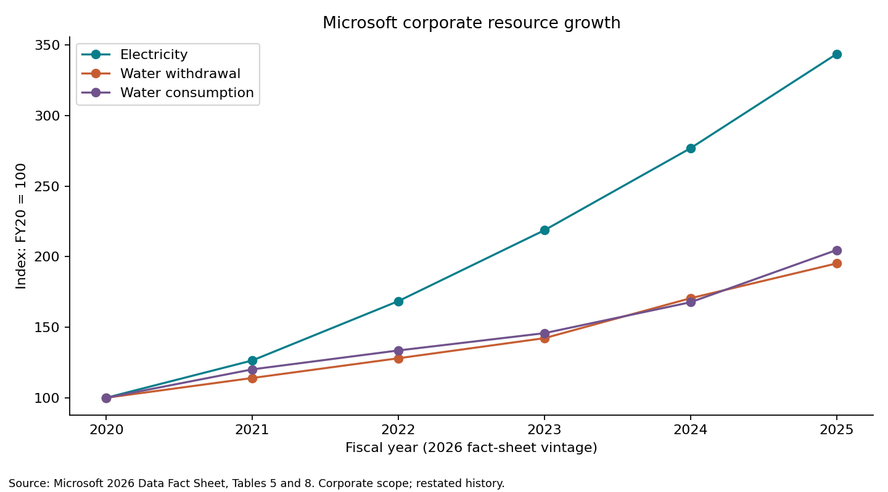

# Data-Center Sustainability Analytics | rithmsAI

**[Explore the interactive case study](https://kaya-rithmsai-portfolio.krobin2411.chatgpt.site/projects/datacenter/)** · [Executed notebook](notebooks/01_exploration.ipynb) · [Sources and reuse terms](SOURCES.md)

**Research question:** What do public disclosures show about energy and water growth, variation across datacenter locations, and the limits of efficiency claims as infrastructure expands?

This working analysis uses Microsoft's 2026 Environmental Data Fact Sheet (FY20-FY25 restated corporate history and FY25 owned datacenter clusters), EIA state retail sales, and DOE/LBNL context. Run the notebook or script to reproduce four figures and cleaned tables offline. See SOURCES.md for exact source URLs, licenses, table locators, hashes, retrieval date, and limitations.

## Run

Use Python 3.12. From this project folder: `python -m venv .venv`, activate it, then `python -m pip install -r requirements.txt`.

1. `python -m unittest discover -s tests -v`
2. `python analysis.py`
3. Open `notebooks/01_exploration.ipynb` in Jupyter or VS Code; Run All. The notebook finds its project root from either the project folder or notebooks folder.

The shipped CSV excerpts are the offline inputs. `data/processed/` and `reports/` are regenerated. `reports/results.json` records computed results. `reports/findings.md` interprets them. `DATA_DICTIONARY.md` explains cleaning and units. `requirements-lock.txt` records the actual verification environment; direct requirements express the intended portable environment.

## Reasoning step by step

1. Establish boundaries before calculating: corporate operations, owned datacenter clusters, US industry estimates, and state electricity sales answer different questions.
2. Compare corporate growth with a common FY20=100 index so MWh and ML are not placed on one misleading raw-value axis.
3. Examine location withdrawal per total facility kWh, including censored observations. This is a screening ratio, not a cooling ranking or causal measure. Climate, utilization, technology, and estimation can explain variation.
4. Show PUE scenarios with a fixed IT workload. PUE = facility energy / IT energy. Overhead includes cooling and power distribution; it is not cooling alone. Microsoft Table 15 cannot supply an observed PUE or WUE.
5. Use EIA regional history as infrastructure context, not a way to attribute state demand growth to AI or Microsoft.
6. Defer ML. Six corporate years and one cross-section are not enough for a reliable predictive claim. A future facility-month panel could support regularized regression against a seasonal naive baseline, with future-month holdouts and location-group holdouts. Require IT load, weather, cooling type, source-water mix, and measured targets first. Avoid training on ratios whose denominator is also a predictor without a clear modeling rationale.

## Infrastructure sustainability beyond resource ratios

Low on-site withdrawal can coexist with upstream electricity water impacts. Water replenishment is a separate intervention and cannot simply be subtracted from consumption at a different watershed or time. Annual renewable matching is not proof of hourly carbon-free supply. Hardware lifetime, reuse, embodied emissions, grid capacity and local water stress matter; this first release does not quantify a complete life-cycle footprint. Microsoft's public report discusses circular hardware, but no unsupported lifecycle score is assigned here.

## Scope and academic use

This is an exploratory portfolio release, not a completed SIS310 submission or an environmental assurance opinion. No SIS310 rubric was available. Project A is the recommended primary sustainability submission if its rubric permits this topic; adapt its discussion and citations to the actual assignment. Disclose AI assistance and explain every calculation yourself. No code license is selected automatically; third-party data retain their own terms.
